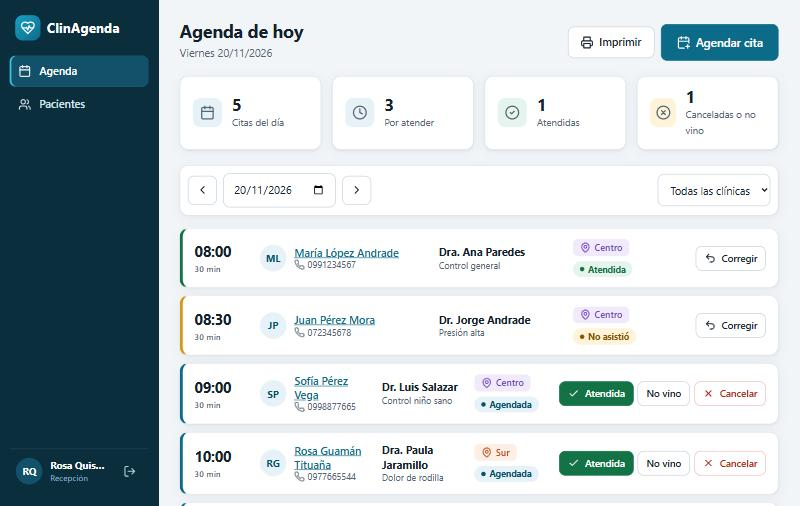

# ClinAgenda

Sistema web sencillo para agendar citas en las tres clínicas de la Dra. Paredes
(Centro, Norte y Sur). Hecho con **Flask + HTML + CSS + PostgreSQL**, pensado para que
lo use personal sin experiencia con computadoras.

Repositorio: https://github.com/GuadalupeOchoa/ClinAgenda



## Documentación

| Documento | Para quién |
|---|---|
| [INSTALACION.md](INSTALACION.md) | Técnico / jurado: instalar en un equipo nuevo y probar en 5 minutos. |
| [docs/MANUAL_USUARIO.md](docs/MANUAL_USUARIO.md) | Recepcionistas, médicos y administradora: uso paso a paso con capturas. |
| [docs/DIAGRAMA_ENTIDAD_RELACION.md](docs/DIAGRAMA_ENTIDAD_RELACION.md) | Modelo de datos, diccionario y relaciones. |
| [DECISIONES.md](DECISIONES.md) | Qué se decidió ante cada pregunta de la clienta, qué quedó fuera y por qué. |

## Qué hace

- **Agenda del día** por clínica, con contadores y botón de imprimir (respaldo en papel).
- **Pacientes**: búsqueda por nombre (sin importar tildes ni mayúsculas), cédula o teléfono.
  Validación de cédula ecuatoriana (dígito verificador), pasaporte o "sin documento",
  teléfono, correo, fecha de nacimiento y representante para menores. Aviso de posible duplicado.
- **Agendar cita** en 4 pasos guiados: clínica → médico → día → hora (solo muestra horas libres).
- **Sin cruces**: la base de datos impide que un médico tenga dos citas a la misma hora,
  aunque sea en clínicas distintas o dos recepcionistas guarden en el mismo segundo.
- **Cancelar** con motivo; la cita no se borra y se puede **deshacer**.
- **Roles**: Administración, Recepción y Médico (el médico solo ve su agenda).
- **Historial de cambios**: quién creó, canceló o cambió qué y cuándo.
- **Respaldo** de la base con `respaldo.ps1`.
- Diseño de letra grande y alto contraste, adaptable a celular y **sin dependencias de internet**.

## Inicio rápido

```powershell
powershell -ExecutionPolicy Bypass -File .\instalar.ps1   # equipo nuevo: instala todo
.\venv\Scripts\python.exe demo_datos.py                  # datos y usuarios de demostración
.\iniciar.bat                                            # abre http://localhost:5000
```

Usuarios de demostración: ver [INSTALACION.md](INSTALACION.md#c-probar-el-sistema-en-5-minutos-para-el-jurado).

## Estructura

```
ClinAgenda/
├── app.py             # Rutas (pantallas) y reglas de negocio
├── db.py              # Conexión a PostgreSQL y bitácora
├── validaciones.py    # Validación de cédula, teléfono, correo, nombres...
├── init_db.py         # Crea la base, tablas, datos iniciales y el administrador
├── demo_datos.py      # Datos de demostración (personas inventadas)
├── sql/               # schema.sql (tablas e índices) y datos_iniciales.sql
├── templates/         # Pantallas HTML (Jinja2)
├── static/css/        # Estilos
├── docs/              # Manual de usuario, diagrama entidad-relación y capturas
├── instalar.ps1       # Instalador para un equipo Windows nuevo
├── iniciar.bat        # Abre el sistema con doble clic
├── respaldo.ps1       # Copia de seguridad de la base
├── .env.example       # Plantilla de configuración (el .env real NO se sube)
├── INSTALACION.md
└── DECISIONES.md
```

## Datos y seguridad

- No se suben datos reales ni credenciales: `.env` y los respaldos están en `.gitignore`.
- Todos los pacientes, médicos y usuarios de ejemplo son **inventados**.
