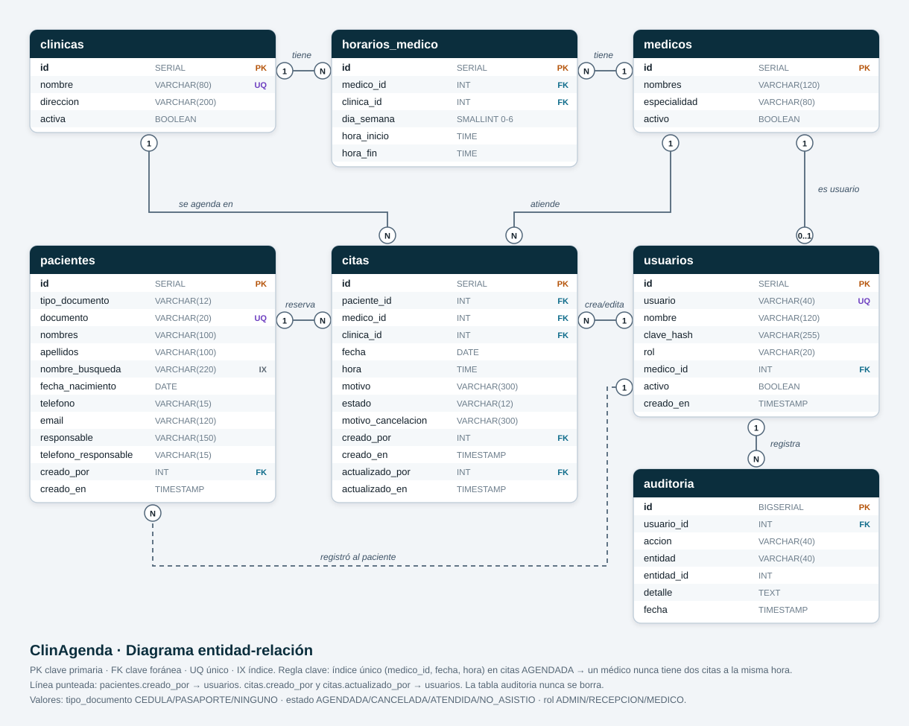
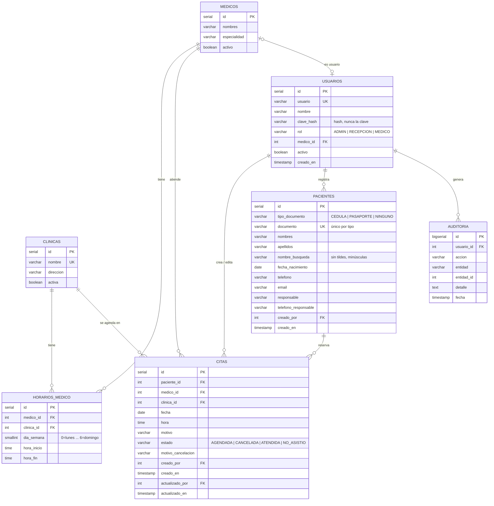

# Diagrama entidad-relación — ClinAgenda

Base de datos **PostgreSQL** `ClinAgenda`. Definición completa en [`sql/schema.sql`](../sql/schema.sql).

## Versión Mermaid

GitHub dibuja este bloque automáticamente.

## Diccionario de datos

| Tabla | Para qué sirve | Reglas importantes |
|---|---|---|
| `clinicas` | Las 3 sedes: Centro, Norte y Sur. | Nombre único. Se puede desactivar sin borrar. |
| `medicos` | Los 12 médicos. | Se desactivan, no se borran (tienen citas históricas). |
| `horarios_medico` | Qué día y a qué hora atiende cada médico en cada clínica. | `hora_fin > hora_inicio`. La aplicación impide que un médico tenga horarios cruzados, aunque sea en clínicas distintas (caso Dr. Salazar). |
| `pacientes` | Datos de cada paciente. | Documento único por tipo (`CEDULA`/`PASAPORTE`). `NINGUNO` permite pacientes sin documento. `nombre_busqueda` guarda el nombre sin tildes y en minúsculas para encontrar duplicados. |
| `citas` | Cada cita agendada. | **Índice único `(medico_id, fecha, hora)` solo para citas `AGENDADA`**: la base de datos impide dar la misma hora dos veces al mismo médico, aunque dos recepcionistas guarden en el mismo segundo. Otro índice impide que un paciente tenga dos citas a la misma hora. Las citas **nunca se borran**: cambian de estado. |
| `usuarios` | Personal que entra al sistema. | Contraseña guardada como hash. Rol `MEDICO` enlazado a su médico (solo ve sus citas). |
| `auditoria` | Bitácora de quién hizo qué y cuándo. | Se escribe en la misma transacción que el cambio. La aplicación no ofrece forma de borrarla. |

## Relaciones

| Relación | Cardinalidad | Significado |
|---|---|---|
| clinicas → horarios_medico | 1 : N | Una clínica tiene muchos horarios de atención. |
| medicos → horarios_medico | 1 : N | Un médico puede atender varios días y en varias clínicas. |
| clinicas → citas | 1 : N | Una clínica recibe muchas citas. |
| medicos → citas | 1 : N | Un médico atiende muchas citas (nunca dos a la misma hora). |
| pacientes → citas | 1 : N | Un paciente puede tener muchas citas en el tiempo. |
| medicos → usuarios | 1 : 0..1 | Un médico puede tener (o no) un usuario para ver su agenda. |
| usuarios → citas / pacientes | 1 : N | Se guarda quién creó y quién modificó por última vez. |
| usuarios → auditoria | 1 : N | Cada acción queda registrada con su autor. |
