# Manual de usuario — ClinAgenda

Guía paso a paso para el personal de las clínicas Centro, Norte y Sur.
Está escrita para personas que **nunca han usado un sistema de computadora**.
No necesita saber de tecnología: siga los pasos en orden.

---

## Contenido

1. [Antes de empezar](#1-antes-de-empezar)
2. [Entrar al sistema](#2-entrar-al-sistema)
3. [La agenda del día](#3-la-agenda-del-día)
4. [Buscar a un paciente](#4-buscar-a-un-paciente)
5. [Registrar un paciente nuevo](#5-registrar-un-paciente-nuevo)
6. [Ver la ficha de un paciente](#6-ver-la-ficha-de-un-paciente)
7. [Agendar una cita](#7-agendar-una-cita)
8. [Cancelar una cita (y deshacerlo)](#8-cancelar-una-cita-y-deshacerlo)
9. [Marcar si el paciente vino o no](#9-marcar-si-el-paciente-vino-o-no)
10. [Imprimir la agenda](#10-imprimir-la-agenda)
11. [Usar el sistema desde el celular](#11-usar-el-sistema-desde-el-celular)
12. [Solo para la administradora](#12-solo-para-la-administradora)
13. [Si algo sale mal](#13-si-algo-sale-mal)
14. [Preguntas frecuentes](#14-preguntas-frecuentes)

---

## 1. Antes de empezar

**¿Quién puede hacer qué?**

| Rol | Quiénes | Qué puede hacer |
|---|---|---|
| **Recepción** | Las 5 recepcionistas | Ver la agenda de las 3 clínicas, buscar y registrar pacientes, agendar, cancelar y marcar citas. |
| **Médico** | Cada doctor | Ver **solo sus propias citas** y marcar si el paciente fue atendido. |
| **Administración** | La Dra. Paredes | Todo lo anterior, más: médicos y horarios, usuarios y el historial de cambios. |

**Reglas importantes**

- Cada persona tiene **su propio usuario y contraseña**. No los preste: el sistema anota quién hizo cada cambio.
- **Nada se borra.** Una cita cancelada queda guardada y se puede recuperar.
- Antes de cada acción importante el sistema le **pregunta si está segura**. Lea la pregunta y responda **Sí** o **No**.
- Si se equivoca, casi todo se puede **deshacer** (busque los botones con la flecha ↩).

---

## 2. Entrar al sistema

1. Abra el navegador (Chrome o Edge) y escriba la dirección que le dio la administradora
   (por ejemplo `http://localhost:5000`).
2. Escriba su **usuario** (por ejemplo `rosa`).
3. Escriba su **contraseña**. Si quiere ver lo que escribe, toque **Mostrar**.
4. Presione el botón azul **Entrar**.

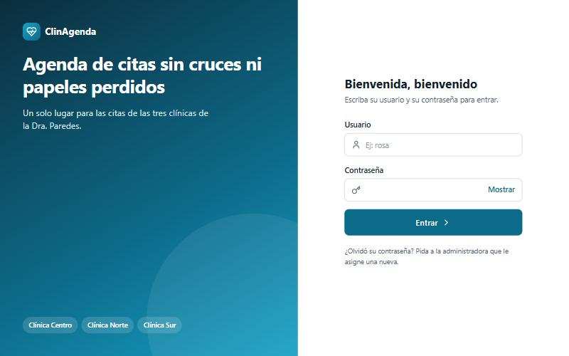

> **¿Olvidó su contraseña?** Pida a la Dra. Paredes que le asigne una nueva.
> **Para salir**, toque el ícono de la puerta (abajo a la izquierda, junto a su nombre).

---

## 3. La agenda del día

Es la primera pantalla que verá. Muestra todas las citas de **hoy**.

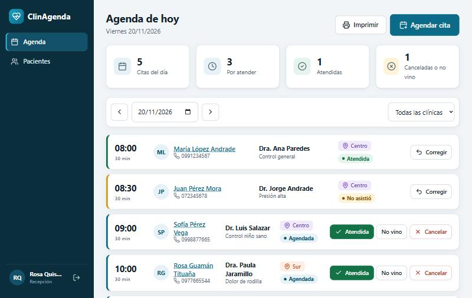

**Qué hay en la pantalla:**

- **Menú de la izquierda:** Agenda y Pacientes (y más opciones si es administradora).
- **Cuadros de arriba:** cuántas citas hay en el día, cuántas faltan por atender, cuántas se atendieron y cuántas se cancelaron o el paciente no vino.
- **Cambiar de día:** use las flechas **‹** y **›**, o toque la fecha para elegir otra.
  Si se movió a otro día, el botón **Volver a hoy** la regresa.
- **Elegir clínica:** en la lista "Todas las clínicas" puede elegir solo Centro, Norte o Sur.
- **Elegir médico:** en la lista "Todos los médicos" puede ver solo las citas de un doctor.
  Si antes eligió una clínica, la lista muestra solo los médicos que atienden en ella.
  Para volver a ver todo, toque **Quitar filtros**.
- **Cada cita** muestra: hora, paciente, teléfono, médico, motivo, clínica y estado.

**Colores de cada clínica:** Centro = morado · Norte = azul · Sur = naranja.

**Estados de una cita:**

| Estado | Significa |
|---|---|
| 🔵 Agendada | La cita está confirmada y aún no ocurre. |
| 🟢 Atendida | El paciente vino y fue atendido. |
| 🟡 No asistió | El paciente no vino. |
| ⚪ Cancelada | Se canceló (aparece tachada). |

---

## 4. Buscar a un paciente

Siempre **busque primero** al paciente antes de registrarlo, para no crearlo dos veces.

1. Toque **Pacientes** en el menú.
2. Escriba en el buscador el **nombre**, el **apellido**, la **cédula** o el **teléfono**.
   No importa si escribe con o sin tildes, en mayúsculas o minúsculas:
   "maria lopez" encuentra a "María López".
3. Presione **Buscar**.
4. En el resultado, toque **Ver ficha** o directamente **Agendar cita**.

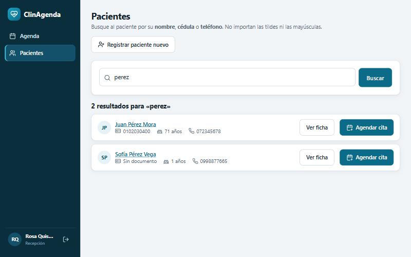

> Si no aparece, pruebe solo con el apellido o con la cédula. Si sigue sin aparecer, regístrelo (paso 5).

---

## 5. Registrar un paciente nuevo

1. En **Pacientes**, toque **Registrar paciente nuevo**.
2. **Tipo de documento:** toque una de las tres opciones:
   - **Cédula** (ecuatoriana, 10 números).
   - **Pasaporte** (para extranjeros).
   - **No tiene** (por ejemplo, un recién nacido). En este caso el número no se pide.
3. Escriba **nombres**, **apellidos** y **fecha de nacimiento**.
4. Escriba al menos **un teléfono**: del paciente o de un familiar.
5. Si el paciente es **menor de edad**, escriba el nombre del **representante** (obligatorio).
6. Presione **Guardar paciente**.

**Si algo está mal**, el sistema **no borra lo que escribió**: marca en rojo el campo y le explica qué corregir.

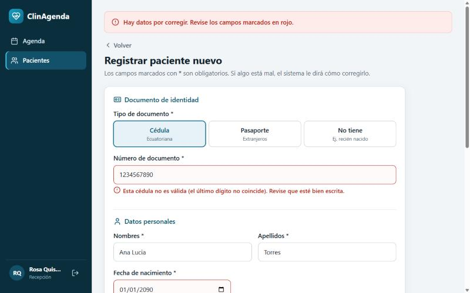

Ejemplos de lo que el sistema revisa:

| Si escribe… | El sistema le dice… |
|---|---|
| Cédula `1234567890` o `0000000000` | Que la cédula no es válida (revisa el dígito verificador y la provincia). |
| Teléfono `12345` | Que el celular debe tener 10 números y empezar en 09. |
| Correo `ana@@gmail` | Que el correo no parece correcto, con un ejemplo. |
| Nacimiento en el año 2090 | Que la fecha no puede ser en el futuro. |
| "  MARÍA   lópez" | Lo acepta y lo guarda ordenado como "María López". |

> **Aviso de posible duplicado:** si ya existe alguien con el mismo nombre y fecha de nacimiento,
> el sistema le muestra quién es. Si es la misma persona, **no la registre otra vez**. Si de verdad es otra
> persona, marque la casilla "Confirmo que es otra persona".

---

## 6. Ver la ficha de un paciente

En la ficha verá sus datos de contacto y **todas sus citas** (pasadas y futuras).

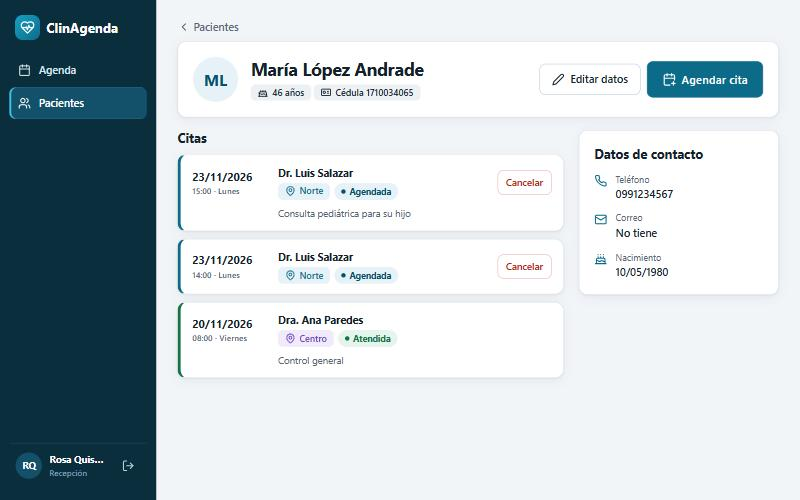

Desde aquí puede:

- **Agendar cita** (botón azul).
- **Editar datos** si cambió de teléfono o había un error.
- **Cancelar** una cita futura, o **Deshacer** una cancelación.

---

## 7. Agendar una cita

El sistema la guía en **4 pasos**. Arriba verá en qué paso va (los pasos hechos se ponen en verde ✓).

1. Busque al paciente (paso 4) y toque **Agendar cita**.
2. **Paso 1 — Clínica:** toque la clínica (Centro, Norte o Sur).
3. **Paso 2 — Médico:** toque el médico. Solo aparecen los que atienden en esa clínica.

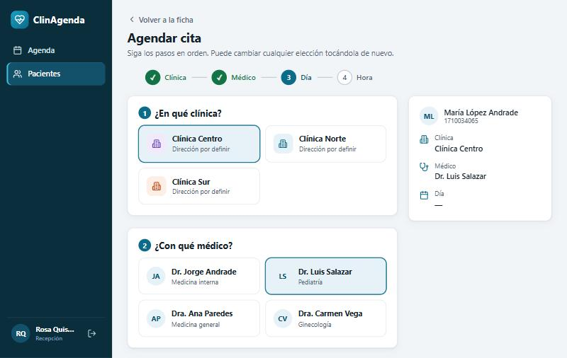

4. **Paso 3 — Día:** toque uno de los días que aparecen. Solo se muestran los días en que ese médico
   atiende en esa clínica. Para otra fecha, use el calendario de la derecha.
5. **Paso 4 — Hora:** si quiere, escriba el **motivo** de la consulta. Luego toque la **hora**.
   Las horas están separadas en **Mañana** y **Tarde**. **Solo aparecen las horas libres.**

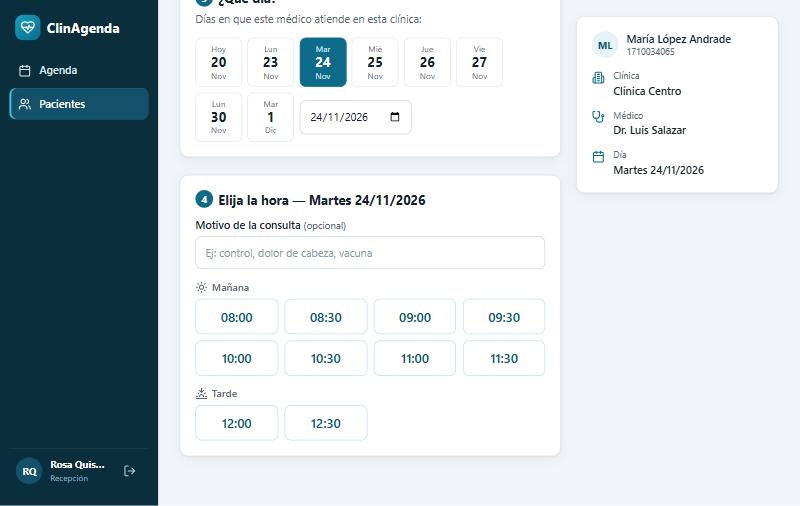

6. El sistema le pregunta si está segura. Revise paciente, médico, día y hora, y toque **Sí, continuar**.

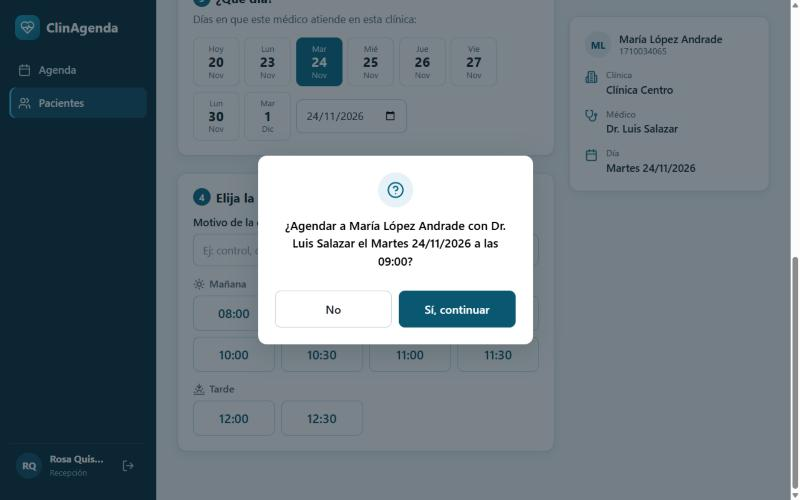

7. Verá el mensaje verde **"Cita agendada"** y la cita aparecerá en la ficha del paciente y en la agenda.

**¿Por qué no aparece una hora?** Porque ya está ocupada, ya pasó, o el médico no atiende a esa hora.
El sistema **no permite** dar la misma hora dos veces al mismo médico, ni siquiera en clínicas distintas
(por ejemplo, el Dr. Salazar atiende en Centro y en Norte, pero nunca a la misma hora).

> **Si dos recepcionistas eligen la misma hora al mismo tiempo**, solo una se guarda. A la otra el sistema
> le avisa: *"Otra persona acaba de tomar ese horario. Elija otro."*

---

## 8. Cancelar una cita (y deshacerlo)

1. En la **Agenda** o en la **ficha del paciente**, toque **Cancelar** en la cita.
2. Escriba **por qué se cancela** (puede elegir un motivo de la lista que aparece al escribir).
3. Toque **Sí, cancelar**. Si se arrepintió, toque **No, volver**.

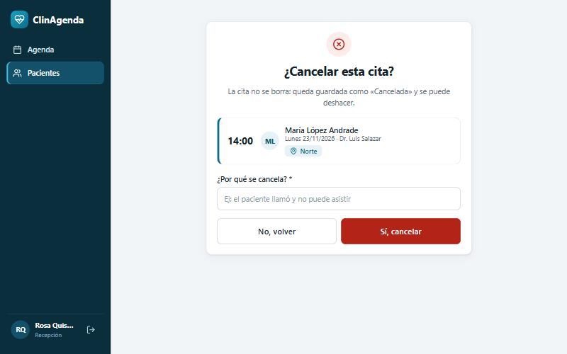

- La cita **no se borra**: queda como "Cancelada" y la hora vuelve a estar libre para otro paciente.
- **¿Se equivocó?** Toque **↩ Deshacer cancelación** en esa cita. Funciona mientras nadie más haya tomado esa hora.
- Si alguien intenta cancelar una cita que ya estaba cancelada, el sistema avisa y no hace nada.

---

## 9. Marcar si el paciente vino o no

En la agenda del día, en cada cita agendada:

- Toque **✓ Atendida** cuando el paciente fue atendido.
- Toque **No vino** si el paciente no llegó (el sistema le pide confirmar).
- ¿Se equivocó? Toque **↩ Corregir** y la cita vuelve a "Agendada".

> Estas opciones solo aparecen el día de la cita (no se puede marcar como atendida una cita futura).

---

## 10. Imprimir la agenda

Toque **Imprimir** en la agenda. Se imprime la lista del día sin botones ni menús.

> **Recomendación:** imprima la agenda **cada mañana**. Si se va la luz, el internet o el sistema,
> tendrá en papel todas las citas del día y podrá seguir atendiendo.

---

## 11. Usar el sistema desde el celular

El sistema se adapta a la pantalla del celular. El menú se abre con el botón **☰** (arriba a la izquierda).

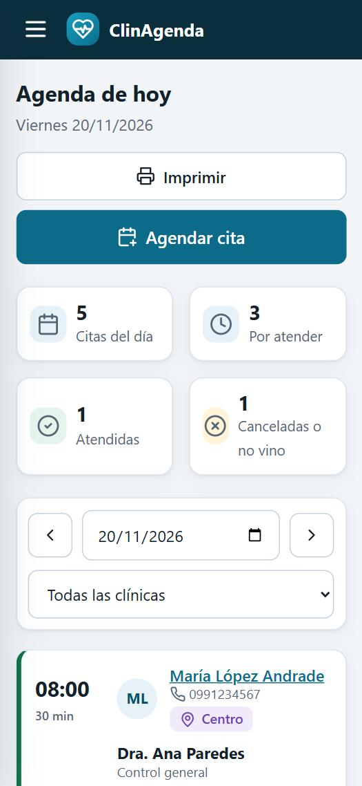

> El celular debe estar conectado a la misma red (wifi) de la clínica donde está instalado el sistema.

---

## 12. Solo para la administradora

### Médicos y horarios

Aquí se crean los médicos y se indica **en qué clínica, qué día y a qué hora atiende** cada uno.
Solo se pueden agendar citas dentro de estos horarios.

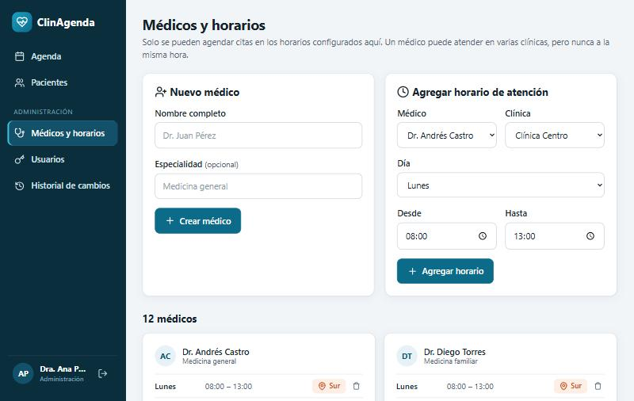

- **Nuevo médico:** escriba el nombre y la especialidad, y toque **Crear médico**.
- **Agregar horario:** elija médico, clínica, día, hora de inicio y fin, y toque **Agregar horario**.
  El sistema no deja que un horario se cruce con otro del mismo médico (aunque sea en otra clínica).
- **Quitar horario:** toque el ícono de la papelera. Las citas ya agendadas **no** se borran.

### Usuarios

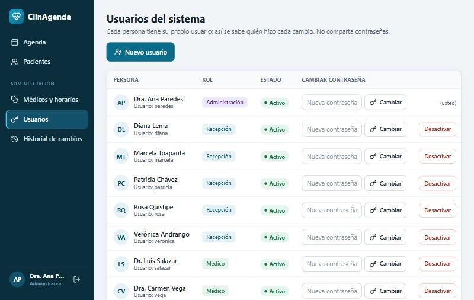

- **Nuevo usuario:** toque el botón, escriba nombre, usuario, rol y contraseña inicial (mínimo 8 caracteres).
  Si es médico, elija cuál es (así solo verá sus citas).
- **Cambiar contraseña:** escriba la nueva en la fila de esa persona y toque **Cambiar**.
- **Desactivar:** si alguien deja de trabajar en la clínica, desactívelo. Ya no podrá entrar,
  pero su historial se conserva. Se puede volver a **Activar**.

### Historial de cambios

Muestra **quién hizo qué y cuándo**: quién creó, canceló, deshizo o cambió cada cita.
No se puede borrar desde el sistema.

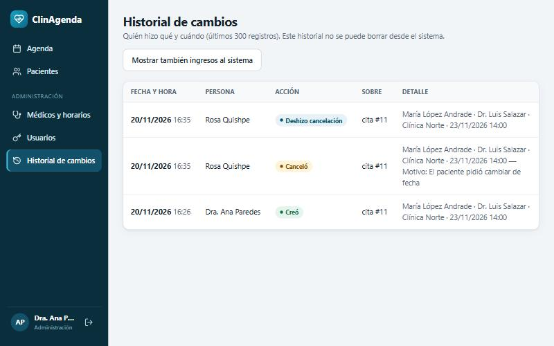

Toque **Mostrar también ingresos al sistema** para ver además a qué hora entró cada persona.

### Copias de seguridad

Pida al técnico que programe la copia diaria (`respaldo.ps1`). Así, si se daña la computadora,
la información se puede recuperar.

---

## 13. Si algo sale mal

| Lo que pasa | Qué hacer |
|---|---|
| Aparece un mensaje **rojo** en un formulario | Lea el mensaje: dice qué corregir. Lo que escribió sigue ahí. |
| *"La página estaba abierta hace mucho tiempo"* | Vuelva a hacer lo que estaba haciendo. Fue por seguridad. |
| *"Otra persona acaba de tomar ese horario"* | Elija otra hora de la lista. |
| *"No hay conexión con la base de datos"* | Espere un minuto e intente otra vez. **No se perdió nada de lo ya guardado.** Si sigue, llame al técnico y use la agenda impresa. |
| No puede entrar | Revise mayúsculas y minúsculas de la contraseña. Si la olvidó, pida una nueva a la administradora. |
| Se cerró la sesión sola | Por seguridad, la sesión dura 8 horas. Vuelva a entrar. |

---

## 14. Preguntas frecuentes

**¿Puedo borrar una cita?**
No. Se cancela, y queda guardada. Así nunca se pierde una cita.

**Un paciente no tiene cédula ni correo. ¿Lo puedo registrar?**
Sí. Elija "No tiene" en el documento. El correo es opcional. Solo se necesita un teléfono
(del paciente o de un familiar) para poder avisarle de su cita.

**Hay dos pacientes con el mismo nombre. ¿Cómo los distingo?**
Por la cédula, la fecha de nacimiento o el teléfono, que aparecen en el resultado de búsqueda.

**¿Puedo agendar una cita para una fecha que ya pasó?**
No. El sistema no lo permite.

**¿Los médicos ven los datos de todos los pacientes?**
No. Cada médico ve solo sus propias citas.
